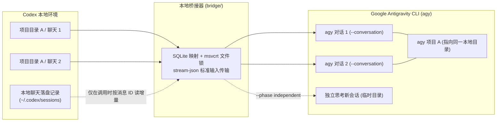

# Codex + Gemini Carbon 双模型协作与会话桥接指南

本仓库提供一套面向 **OpenAI Codex（Desktop App / CLI）** 与 **Google Antigravity CLI（`agy`）** 的本地协作配置方案及 Python 会话桥接工具，在不迁移现有项目目录与开发环境的前提下，实现 **“Codex 负责代码执行与事实核验 + Gemini Carbon 负责独立判断撰稿、图表排版与双模型隔离商讨”** 的工作流。

---

## 相比初版教程的主要更新

相比早期仅用单条 `agy -p` 命令手工拼提示词的做法，当前版本新增并修正了以下内容：

1. **项目与聊天 1↔1 映射（防并行串线）**：新增 `bridge/bridge.py`，按规范化项目根目录与 `CODEX_THREAD_ID` 按需建立并锁定 `Codex 项目 ↔ agy 项目`、`Codex 聊天 ↔ agy 对话` 映射；续接时显式使用 `--conversation`，不使用 `--continue`。
2. **本地对话按需增量同步**：新增 `bridge/history.py`，复用本机已落盘的当前聊天记录，在需要 Gemini 协作时通过 `stream-json` 标准输入一次性补齐未同步的纯文本问答增量，无需后台常驻进程，也不必每发一条消息都调用模型。
3. **双模型商讨两阶段物理分流**：拆分为 `--phase independent`（全新会话 + 临时目录，不传 Codex 观点、不读日常增量）与 `--phase synthesis`（校验同项目同聊天归属后对比汇总）。
4. **独立撰稿与严谨边界校正**：更新全局 `AGENTS.md` 模板（要求传入用户完整原话与一手事实供 Gemini 独立判断，再由 Codex 复核事实）；修正了初版教程中关于跨端额度池绝对分离、必须强制重启客户端等缺乏官方稳定依据的表述。
5. **文件与图片读取确认**：按需传递本地文件路径；可从当前聊天指定消息临时还原内嵌图片，并根据实际工具记录逐项返回读取状态。图片理解能力仍需另行核验。

---

## 仓库目录结构

```text
.
├── bridge/
│   ├── bridge.py          # 核心桥接入口：项目/会话映射、文件锁、stream-json 调用与三阶段调度
│   ├── history.py         # 本地增量读取：按 CODEX_THREAD_ID 解析当前会话已落盘的纯文本增量
│   ├── test_bridge.py     # 映射、增量和独立会话测试
│   └── test_history.py    # 聊天身份和文本筛选测试
├── .gitignore
└── README.md
```

---

## 一、 核心分工与协作架构

| 角色 | 运行工具 / 模型 | 核心职责 |
| :--- | :--- | :--- |
| **执行与事实核验者** | OpenAI Codex（软件端 / CLI） | 编写代码、运行命令、排查故障、整理未经改动的**用户完整原话**与**一手客观事实**；对 Gemini 成稿做事实复核后交付或写入外部文档 |
| **独立撰稿与商讨者** | Gemini Carbon（本地 `agy` CLI，`plan` 模式） | 基于用户原话与一手事实独立判断并撰写通俗中文汇报（避免沦为 Codex 措辞的机械翻译）；设计表格与 Mermaid 图表；在隔离阶段独立提出方案并负责二阶段汇总 |



---

## 二、 环境要求与前置准备

1. **操作系统与 Python 环境**
   - **桥接脚本（`bridge/`）当前仅针对 Windows 实现并测试**（内部使用 Windows 标准库 `msvcrt` 文件锁），需本机安装 **Python 3.10+**。
   - macOS / Linux 用户可参考官方文档使用基础 `agy` 命令，但本仓库 Python 桥接脚本尚未在其他操作系统测试，不作跨平台可用性承诺。
2. **Codex 客户端**
   - 本机已安装并登录 Codex Desktop App 或 Codex CLI（共用 `~/.codex/` 配置目录，参考 [Codex AGENTS.md 官方文档](https://learn.chatgpt.com/docs/agent-configuration/agents-md)）。
3. **Google Antigravity CLI（`agy`）与账号权限**
   - 拥有可使用 Antigravity 及对应 Gemini Carbon 模型的 Google 账号，且本机网络可正常访问相关服务。
   - 额度消耗与 Agent 实际工作量及个人订阅/超额设置相关，具体规则以 [Antigravity Plans 官方说明](https://antigravity.google/docs/plans) 为准。
4. **安全与隐私前置提醒**
   - 启用增量同步后，**首次在已有聊天中调用桥接器可能会将该聊天此前的历史文本发送至 Google 服务端**。
   - 配置与使用前请自行划定数据合规边界：妥善保管本机凭据，不要对包含敏感机密或禁止外发内容的项目启用同步，也不建议安装来源不明的第三方非官方桥接组件。

---

## 三、 五步上手配置

### 第 1 步：安装 Antigravity CLI（`agy`）

请优先以 Google Antigravity 官方最新安装文档为准。常见终端安装命令参考如下（未在所有系统环境逐一重验）：

**Windows（PowerShell）**：
```powershell
irm https://antigravity.google/cli/install.ps1 | iex
```

**Windows（CMD 命令提示符）**：
```cmd
curl -fsSL https://antigravity.google/cli/install.cmd -o install.cmd && install.cmd && del install.cmd
```

**macOS / Linux（仅基础 CLI 参考）**：
```bash
curl -fsSL https://antigravity.google/cli/install.sh | bash
```

安装后**重新打开一个终端窗口**，确认可正常输出版本号：
```powershell
agy --version
```

### 第 2 步：登录 Google 账号并核对模型 ID

1. 在终端运行 `agy` 启动一次交互界面，按提示通过浏览器完成 Google OAuth 登录，完成后按 `Ctrl + C` 退出。
2. 运行以下命令核对当前账号实际可用的模型名称：
   ```powershell
   agy models
   ```
   确认列表中包含日常默认模型（如 `gemini-4-carbon-medium`）、深度任务模型（如 `gemini-4-carbon-high`）及备用模型（如 `gemini-4-neon-high`）。若官方更新了模型命名，请以 `agy models` 的实际输出为准。

### 第 3 步：最小无头调用验证（Headless）

在终端执行单句只读测试，确认无头模式能正常返回结果（参考 [Antigravity Headless CLI 文档](https://antigravity.google/docs/cli/headless)）：

```powershell
agy --model gemini-4-carbon-medium --mode plan -p "用一句话确认收到"
```

> **参数顺序注意**：直接使用 `agy` 命令时，`--model`、`--mode` 等选项必须放在 `-p` 之前，`-p` 后紧跟提示词字符串。

### 第 4 步：克隆本仓库到本地固定目录

在 Windows 上选择一个固定目录克隆本仓库（后续全局规则需引用该绝对路径，请勿放在易被清理的临时文件夹）：

```powershell
git clone https://github.com/LinJi0215/codex-gemini-carbon-guide.git C:\tools\codex-agy-bridge
cd C:\tools\codex-agy-bridge
python -m unittest discover -s bridge -p "test_*.py" -v
```

记下桥接脚本的实际绝对路径，例如：`C:\tools\codex-agy-bridge\bridge\bridge.py`。

### 第 5 步：配置全局协作规则（`~/.codex/AGENTS.md`）

打开用户主目录下的 `.codex\AGENTS.md`（Windows PowerShell 可运行 `mkdir -Force "$env:USERPROFILE\.codex"; notepad "$env:USERPROFILE\.codex\AGENTS.md"`）：

- **若文件已有个人规则**：请保留原有内容，在文件末尾空两行后追加下方模板，并根据自身需求合并冲突项。
- **务必替换占位符**：将模板中所有 `<你的仓库克隆目录>` 替换为你本机真实的仓库路径（如 `C:/tools/codex-agy-bridge`）。

```markdown
# 协作分工规则：Codex（执行与核验） + Gemini Carbon（独立判断汇报与商讨）

## 角色定位与模型原则
- **Codex（你）**：负责写代码、执行命令、排查问题、准备未经改动的完整用户原话与一手客观事实，并在收到 Gemini 稿件后复核事实准确性再向用户交付（或按指令写入外部文档）。
- **Gemini（通过本地 `agy` 及桥接脚本调用）**：工作于只读 `plan` 模式，负责基于用户原话与一手事实独立判断撰稿（不得仅把 Codex 的结论做大白话翻译）、设计表格与 Mermaid 图表，以及参与双模型方案商讨。
- **默认模型与禁静默降级**：默认使用 `gemini-4-carbon-medium`（复杂任务可用 `gemini-4-carbon-high`，以 `agy models` 为准）。若遇额度不足或限流报错，必须先如实告知用户，未经用户明确同意严禁自行切换至 `gemini-4-neon-high`。

## 规则 1：日常任务汇报（走桥接与会话增量同步）
当完成代码修改、排查或分析准备向用户汇报，或用户要求由 Gemini 汇报/排版时：
1. 将**未经改动的完整用户原话**写入 UTF-8 临时文件 `<用户原话文件>`，将**相关背景与一手事实（改动清单、命令/测试结果、文件路径，区分已验证事实与未知项）**写入 UTF-8 临时文件 `<背景事实文件>`。
2. 调用本地桥接脚本（在 Codex 会话内自动读取 `CODEX_THREAD_ID`，脚本会自动按项目根目录与当前聊天建立或续接映射，并补齐当前聊天未同步的纯文本增量）：
   `python "<你的仓库克隆目录>/bridge/bridge.py" --root "<当前项目根目录>" --user-file "<用户原话文件>" --context-file "<背景事实文件>"`
3. 核验与交付：核对返回的 `response` 未编造事实或越界承诺后，保留其结构、文字与图表向用户输出，并在末尾附上涉及的文件路径（随后清理临时输入文件）。

## 规则 2：双模型商讨方案 / Idea（先物理分流独立思考，再对比汇总）
当用户明确要求“和 Gemini 商讨方案/Idea”时，讨论阶段严禁修改项目代码：
1. **第一阶段（各自独立出方案）**：
   - 你先独立形成自己的方案，但**严禁写入传给 Gemini 的第一阶段文件中**。
   - 准备仅含纯客观事实与约束、**不含任何 Codex 观点或倾向**的 `<中立事实文件>`，运行独立阶段命令（开启全新会话与临时目录，不读取日常聊天增量）：
     `python "<你的仓库克隆目录>/bridge/bridge.py" --phase independent --root "<当前项目根目录>" --user-file "<用户原话文件>" --context-file "<中立事实文件>"`
   - 记录输出 JSON 中的 `conversation_id`。
2. **第二阶段（对比与汇总）**：
   - 将双方已完成的独立方案共同写入 `<双方方案材料文件>`，使用第一阶段登记在同一项目与同一聊天下的 `conversation_id` 发起汇总：
     `python "<你的仓库克隆目录>/bridge/bridge.py" --phase synthesis --independent-id "<第一阶段conversation_id>" --root "<当前项目根目录>" --user-file "<用户原话文件>" --context-file "<双方方案材料文件>"`
   - 由 Gemini 对比双方方案、保留关键分歧并给出综合建议，经你核对事实后转交用户。

## 规则 3：跨会话读取与禁访边界
- 当你在当前聊天中按用户指示读取了另一个 Codex 聊天记录后需要与 Gemini 协作时，桥接调用仍保持当前聊天的路由，不会自动同步另一个聊天。
- 如任务依赖被读取聊天的前情，须将其中的**用户原话与客观证据注明来源**后放入背景文件；若处于双模型独立思考第一阶段，必须剔除旧聊天中任何模型的既有分析或方案观点。
- 严格遵守用户的项目隐私与禁访边界，不得将禁止共享或未授权项目的内容传入桥接器。

## 规则 4：回复末尾如实标注来源
每条面向用户的回复末尾，按实际情况单独标注以下之一：
- **Gemini Carbon 撰稿**：已实际调用 Gemini Carbon，正文采用其成稿（若有事实校正须如实说明）。
- **Codex 撰写**：简单问答、进度同步或规则确认等由 Codex 直接撰写。
- **Gemini 未调用成功**：如实说明报错或限流原因，未经确认不静默切换模型。
- 若用户同意临时切换到其他模型，应如实说明实际模型，不能标注为 Carbon。

## 规则 5：需要读取的本地文件与图片
日常汇报中，按需使用 `--file` 传入允许共享的本地文件路径，或使用 `--chat-image-message` 指定当前聊天中需要的图片消息。核对返回的 `file_status`，不要仅凭路径或模型自述认定读取成功；读取工具的结果也不保证内容完整或正确理解。图片临时文件正常结束后删除，异常终止可能遗留。独立思考首轮不传文件路径和附件，始终遵守项目隐私和云端共享限制。

## 规则 6：技术问答表达
涉及技术细节、研究资料或项目判断时，Codex 核对证据、形成判断，并将用户原话、必要背景、一手证据和 Codex 判断交 Gemini Carbon 综合评估、优化表达；Codex 复核技术事实后交付。用户明确要求双模型独立商讨时，首轮不得向 Gemini 发送 Codex 草稿或观点。简单问答、进度和规则解释可以由 Codex 直接回复。

对 Gemini 成稿，重点核对重大事实错误、重要遗漏及影响结论或决策的误导；发现此类问题时提供证据请 Gemini 修正。一般风格和措辞习惯可简短提醒或留待下次提醒，不必仅因此要求重写；用户对某次回复的明确表达要求仍应遵守。
```

当前桥接脚本固定调用 `gemini-4-carbon-medium`，不提供切换模型的参数。模板中的高思考等级或 Neon 是需要另行调整调用方式才能使用的选项，不会自动切换。

保存文件后，可在当前或新建的 Codex 聊天中发送 `确认一下你当前加载了哪些关于 Gemini 的协作规则` 进行核实。如果此前早已打开的旧聊天窗口尚未反映新规则，新建一个聊天或重开对应会话后再验证即可（无需强制重启系统或清理托盘）。

---

## 四、 桥接脚本调用说明（`bridge/bridge.py`）

### 1. 参数与会话 ID 来源说明

- `--root <项目目录>`：目标项目的本地目录路径（脚本会做路径规范化）。
- `--user-file <文件路径>`：UTF-8 编码文本文件，存放未经修改的用户原始指令。
- `--context-file <文件路径>`：UTF-8 编码文本文件，存放一手事实、背景或二阶段汇总材料。
- `--phase {report,independent,synthesis}`：运行阶段，默认为 `report`。
- `--independent-id <UUID>`：仅在 `--phase synthesis` 时必填，传入当前项目、当前聊天在 `independent` 阶段返回的 `conversation_id`。
- `--thread-id <UUID>`：在 Codex 会话内部运行时，环境可能提供 `CODEX_THREAD_ID`；若变量缺失可显式提供 `--thread-id`。日常 `report` 模式的历史读取还要求环境变量 `CODEX_THREAD_ID` 存在，且与指定 ID 相同；仅传 `--thread-id` 并不足以在普通外部终端启用历史同步。
- `--trace`（可选）：在返回结果中附带工具调用轨迹。**注意：`--trace` 输出可能包含本机敏感路径与工具读取片段，公开贴出日志前请务必脱敏。**
- `--file <文件路径>`（可重复，日常汇报）：传递本次需要读取的本地文件路径，并返回对应的工具读取状态。
- `--chat-image-message <消息ID>`（可重复，日常汇报）：按消息 ID 临时还原当前聊天中的指定用户消息内嵌图片，供本次读取；需先从当前聊天记录定位 ID。
- `--timeout-seconds <秒>`（可选）：本次等待上限，默认 0 表示不设固定截止时间；如需手动指定，可设 30–3600 秒。超时只表示未取得完整结果，服务端可能仍在处理；脚本不自动重试，应先核实原会话状态。

桥接器持续读取 agy 的流式事件，并每 180 秒向标准错误输出等待时间和本地会话索引状态。索引可能滞后；进程存活、缺少事件或索引状态不能证明模型正在推理。调用者可根据实际信息向用户汇报。桥接器不自动向运行中的轮次发送追问，避免产生新轮次或打断任务。

为支持无交互模式读取本次明确指定的文件，脚本仅为每个已存在的文件配置本次调用的临时 `read_file` 允许规则，保留已有的 `ask`、`deny` 和 `allow`，不会授予整个目录、文件写入或全部工具权限，也不修改永久配置。用户应只指定允许共享的文件；系统权限和更高优先级的拒绝规则仍然生效。

### 2. 三种模式调用示例

**日常汇报（默认 `report` 阶段，自动建映射 + 批量同步当前聊天未发纯文本增量）**：
```powershell
python "C:\tools\codex-agy-bridge\bridge\bridge.py" `
  --root "D:\work\example-project" `
  --user-file "D:\temp\user_prompt.txt" `
  --context-file "D:\temp\task_facts.txt"
```

**双模型商讨 — 第一阶段（`independent`，全新会话 + 隔离临时目录）**：
```powershell
python "C:\tools\codex-agy-bridge\bridge\bridge.py" `
  --phase independent `
  --root "D:\work\example-project" `
  --user-file "D:\temp\user_prompt.txt" `
  --context-file "D:\temp\neutral_facts.txt"
```

**双模型商讨 — 第二阶段（`synthesis`，校验同项目同聊天后汇总）**：
```powershell
python "C:\tools\codex-agy-bridge\bridge\bridge.py" `
  --phase synthesis `
  --independent-id "<第一阶段返回的conversation_id>" `
  --root "D:\work\example-project" `
  --user-file "D:\temp\user_prompt.txt" `
  --context-file "D:\temp\both_proposals.txt"
```

### 3. 返回 JSON 关键字段

脚本标准输出返回 UTF-8 JSON，核心字段包括：
- `response`：Gemini 返回的正文内容。
- `conversation_id`：本次使用的 `agy` 会话 UUID。
- `usage`：`agy` 返回的当前会话累计 token 统计信息（含 `input`、`output`、`thinking`、`cache_read` 等字段，见 [Headless CLI 文档](https://antigravity.google/docs/cli/headless)）。
- `synced_messages`：`report` 阶段本次成功同步并更新游标的本地历史消息条数。
- `omitted_attachment_markers`：本次增量中未同步的非文本附件占位数；手动指定还原图片后，历史文本里的占位数仍会保留，需结合 `file_status` 判断本次实际文件读取。
- `file_status`：`read_tool_succeeded` 表示对应读取工具完成且有输出；`read_tool_completed_unconfirmed` 表示工具完成但输出不足以确认；`read_failed` 为工具报错；`not_found` 为本地文件不存在；`not_confirmed` 为没有匹配工具记录。另有 `local_permission_denied`、`not_a_file`、`local_error` 等本机检查状态。以上状态不证明模型完整理解文件内容。

---

## 五、 工作机制细节与已知限制（请在使用前阅读）

为了避免误判安全边界或产生不切实际的预期，请留意以下实情与技术限制：

1. **按需批量同步 ≠ 后台实时同步或零推理写入**
   - 桥接器没有后台守护进程，不会在你每发一条消息时自动运行。
   - 根据 [Headless CLI 文档](https://antigravity.google/docs/cli/headless)，通过 `stream-json` 标准输入向 `agy` 发送消息会触发模型推理轮次；因此采用“平时仅依赖 Codex 本机落盘，需要汇报时一次性打包增量送入”来减少调用次数。
   - 只有 `agy` 返回成功后才会更新已同步消息游标；若中途网络或限流失败不会标记成功，下次重试时可能重复发送未落库部分。
2. **增量读取范围与内部格式依赖**
   - `bridge/history.py` 仅读取当前 `CODEX_THREAD_ID` **已落盘的纯文本用户消息与最终答复**——不保证捕获尚未写盘的进行中消息，不包含工具输出、系统注入指令与中间推理过程，也绝不自动跨会话读取其他聊天。
   - 图片等非文本附件的增量消息仍以占位符表示；需要图片时，可由 Codex 传现有文件路径或使用 `--chat-image-message` 按需还原当前聊天中指定消息的内嵌图片。临时图片正常调用结束后删除，异常终止可能留下文件。其他无法恢复的附件需要另行提供。会话身份核验不通过、权限不足或记录缺失时，脚本会中止并报错说明。
   - 用户聊天被移动到其他项目时，以最近一次已保存的 `turn_context.cwd` 判断当前项目，且仍核验聊天 ID 和来源；首次同步可能包含该聊天之前的文本，请先确认允许共享。
   - 历史读取依赖 `~/.codex/sessions` 的客户端内部非公开存储格式，`agy` 项目核对依赖其本地会话索引结构（参考 [Antigravity Projects 文档](https://antigravity.google/docs/projects?tab=cli)）；任一客户端升级调整本地存储格式后，脚本可能需要同步更新。
3. **目录映射与本地文件读取权限边界**
   - 项目映射以**规范化本地路径**为键（而非抽象项目 ID），同一仓库的不同 Git Worktree 会被视为不同项目分别映射。
   - 两边指向同一目录仅提供潜在可访问路径范围，**不等于项目文件已一次性读入模型上下文**。虽然在作者本机 Windows 环境的一次测试中，Gemini 通过默认桥接调用 `read_file` 成功读取了同项目下的测试文本文件，但这受限于具体机器的目录配置、Codex 沙箱与 `agy` 权限策略（参考 [Antigravity CLI Permissions 文档](https://antigravity.google/docs/cli/permissions)），**不能保证所有读者环境与所有项目目录均可无阻碍直接读取**。
4. **独立商讨阶段的隔离性质**
   - `--phase independent` 通过新建会话、使用独立临时工作目录（不指向原项目目录、不加载日常聊天增量）以及提示词约束来避免先入为主，但这属于**工作流分流设计，并非经过操作系统级权限验证的强制安全沙箱**；输入背景是否真正中立仍取决于传入文本是否排除了模型倾向。
5. **上下文窗口压缩与额度不可定量承诺**
   - `stream-json` 标准输入规避了 Windows 命令行长度上限，但模型本身的上下文窗口上限依然存在；长对话达到上限时早期内容会被压缩（参考 [Context and Tokens 文档](https://antigravity.google/docs/learn/context-and-tokens)），不保证完整历史永久原样保留在有效上下文中。
   - 额度消耗取决于上下文规模、缓存命中与个人订阅方案（参考 [Antigravity Plans 文档](https://antigravity.google/docs/plans)），本工具不对费用或配额消耗作定量保证。

---

## 六、 常见问题排错（FAQ）

- **Q1：Windows 运行 `irm ...` 提示不是内部或外部命令？**  
  说明当前窗口是 CMD 而非 PowerShell。请改用 PowerShell 执行，或使用 CMD 对应的安装方式并查阅官方最新文档。
- **Q2：手动在终端运行 `bridge.py` 提示缺少有效 `thread_id`？**  
  普通终端没有 Codex 会话自动注入的 `CODEX_THREAD_ID` 环境变量。若仅测试独立阶段或指定会话，需显式加上 `--thread-id <合法UUID>`；日常在 Codex 聊天内按 `AGENTS.md` 触发时会自动携带当前会话 ID。
- **Q3：日常汇报同步时报错中止，或聊天包含图片怎么办？**
  身份核验、权限或记录格式出错时，`history.py` 会停止同步并说明原因。附件默认只显示占位；需要时指定文件路径或当前聊天的图片消息，并核对 `file_status`。文件路径和模型自述不代表已读到内容；图片是否被正确识别需单独核验。
- **Q4：第一次在 Codex 里触发桥接时弹出命令执行/联网授权提示？**  
  属于 Codex 沙箱的正常安全机制。核对命令路径确实为你本人克隆的 `bridge/bridge.py` 及本机 `agy` 后，按需授权即可。

---

## 七、 官方参考文档

- [Codex AGENTS.md 配置说明](https://learn.chatgpt.com/docs/agent-configuration/agents-md)
- [Antigravity CLI Headless 模式文档](https://antigravity.google/docs/cli/headless)
- [Antigravity Projects 项目与目录说明](https://antigravity.google/docs/projects?tab=cli)
- [Antigravity CLI Permissions 权限说明](https://antigravity.google/docs/cli/permissions)
- [Antigravity Plans 订阅与额度说明](https://antigravity.google/docs/plans)
- [Antigravity Context and Tokens 上下文机制说明](https://antigravity.google/docs/learn/context-and-tokens)
